# Data model

Each service owns its own database. Locally both databases live on one SQL Server container (`wardrobe` and `outfit`). In Azure they are two serverless databases on one logical server (`sdd-3b-g7-wardrobe-db` and `sdd-3b-g7-outfit-db`). The tables below match the migration files exactly.

```mermaid
erDiagram
    ITEMS ||..o{ WEARS : "worn as (item_id, no foreign key)"

    ITEMS {
        int id PK "IDENTITY"
        nvarchar_100 name "NOT NULL"
        nvarchar_20 category "top, bottom, shoes or outerwear"
        nvarchar_30 color "NOT NULL"
        tinyint warmth "1 to 5"
        decimal_10_2 price "0 or more"
        datetime2 created_at "default SYSUTCDATETIME()"
    }

    WEARS {
        bigint id PK "IDENTITY"
        int item_id "id of an item in the wardrobe database"
        date worn_on "NOT NULL"
    }
```

The dotted line means the link is logical only. `wears.item_id` points at `items.id`, but the two tables are in different databases, so SQL Server cannot enforce it.

## Wardrobe database

Owned by wardrobe-service. Migration: [`services/wardrobe/migrations/001_create_items.sql`](../services/wardrobe/migrations/001_create_items.sql).

**`dbo.items`**: one row per piece of clothing.

| Column | Type | Rule |
|--------|------|------|
| `id` | `INT IDENTITY` | primary key, set by the database |
| `name` | `NVARCHAR(100)` | required |
| `category` | `NVARCHAR(20)` | `top`, `bottom`, `shoes` or `outerwear` (`CK_items_category`) |
| `color` | `NVARCHAR(30)` | required, the UI sends a hex color such as `#1f3a93` |
| `warmth` | `TINYINT` | 1 to 5 (`CK_items_warmth`) |
| `price` | `DECIMAL(10, 2)` | 0 or more (`CK_items_price`) |
| `created_at` | `DATETIME2` | set by the database in UTC |

The API checks the same rules before writing (`services/wardrobe/app/items.py`), so a bad request gets a 422 that names the field instead of a database error.

## Outfit database

Owned by outfit-service. Migration: [`services/outfit/migrations/001_create_wear_log.sql`](../services/outfit/migrations/001_create_wear_log.sql).

**`dbo.wears`**: one row per item per day it was worn.

| Column | Type | Rule |
|--------|------|------|
| `id` | `BIGINT IDENTITY` | primary key |
| `item_id` | `INT` | id of an item in the wardrobe database |
| `worn_on` | `DATE` | not in the future (checked by the API) |

Index `IX_wears_item_id_worn_on` on `(item_id, worn_on)` keeps the per-item counts and "last worn" lookups fast.

## Migration history

Both databases also have **`dbo.schema_migrations`** (`version NVARCHAR(255)` primary key, `applied_at DATETIME2`). Each service applies its `migrations/*.sql` files in name order on startup and records each file there, so a migration never runs twice. A schema change is always a new numbered file, never an edit to an old one.

## How the two sides relate

- Outfit-service stores only item ids. Logging a wear keeps working while wardrobe-service is down.
- For stats, outfit-service fetches the items from `GET /items` and joins them with its wears in code (`services/outfit/app/stats.py`).
- Deleting an item does not delete its wears. The stats only loop over items that still exist, so those wears are simply ignored.
